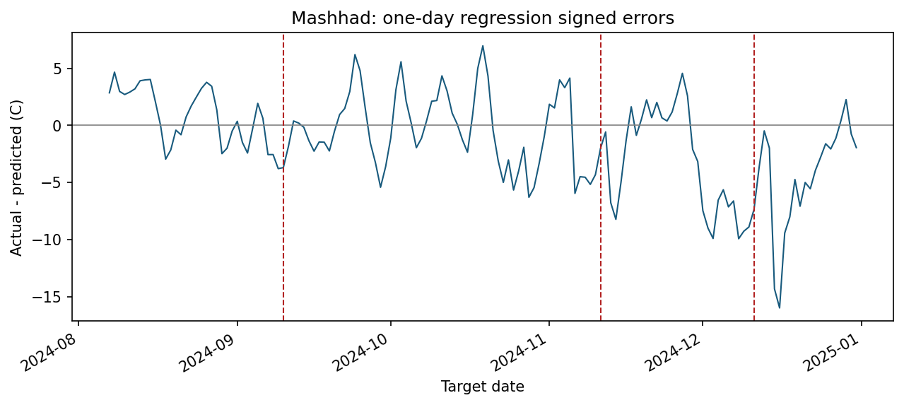

# پایش خطای پیش‌بینی یک‌روزهٔ مشهد

این آزمایش فقط تغییر **خطای مدل** را می‌سنجد. CSV قدیمی پروژه منشأ و تعریف دقیق `Temperature_C` تأییدشده‌ای ندارد؛ بنابراین نتیجه، شاهدی برای تغییر اقلیم، کیفیت پیش‌بینی زنده یا دقت پنج شهر نیست.

## داده و روش

از [آزمایش پیش‌بینی یک شهر](ONE_CITY_FORECAST_EVAL.md)، ۱۴۷ پیش‌بینیِ هدف‌های روزانهٔ ۲۰۲۴-۰۸-۰۷ تا ۲۰۲۴-۱۲-۳۱ استفاده شد. رگرسیون تقویمی روی ۵۸۴ روز نخست آموزش دیده و در این ۱۴۷ روز ثابت مانده است. خطای علامت‌دار `actual - predicted` است: مثبت یعنی مدل دما را کمتر از واقعیت و منفی یعنی بیشتر از واقعیت پیش‌بینی کرده. مبنای مقایسه دمای واقعی روز قبل است.

روی خطاها به ترتیب تاریخ، `river==0.27.0` و `PageHinkley(min_instances=30, delta=0.005, threshold=50.0, alpha=0.9999, mode="both")` اجرا شد؛ این‌ها تنظیمات پیش‌فرض [مستندات River](https://riverml.xyz/dev/api/drift/PageHinkley/) هستند. پس از هر هشدار، برای مقایسه ۱۴ روز قبل و ۱۴ روز بعد را، **بدون روز هشدار**، برداشتیم. این پنجره‌ها برای هر دو روش یکسان‌اند. تنظیمات روی دورهٔ آزمون جست‌وجو یا بهینه نشده‌اند. اسکریپت هش و تاریخ‌های ورودی را با فرادادهٔ آزمایش قبلی تطبیق می‌دهد.



## نتیجه

در کل دوره، MAE رگرسیون **۳٫۲۸°C** و MAE مبنای ماندگاری **۱٫۸۶°C** است. میانگین خطای علامت‌دار رگرسیون **۱٫۲۵-°C** است، یعنی در این دوره به‌طور متوسط بیش‌برآورد کرده است. Page–Hinkley در سه تاریخ زیر هشدار داد:

| تاریخ تشخیص | خطای علامت‌دار رگرسیون، قبل → بعد (°C) | MAE رگرسیون، قبل → بعد (°C) | MAE ماندگاری، قبل → بعد (°C) |
|---|---:|---:|---:|
| ۲۰۲۴-۰۹-۱۰ | ۰٫۷۴- → ۰٫۰۶ | ۱٫۸۴ → ۱٫۶۸ | ۱٫۶۰ → ۱٫۱۶ |
| ۲۰۲۴-۱۱-۱۱ | ۱٫۸۴- → ۰٫۹۶- | ۳٫۹۵ → ۲٫۲۹ | ۲٫۱۸ → ۲٫۱۱ |
| ۲۰۲۴-۱۲-۱۱ | ۵٫۶۱- → ۶٫۰۴- | ۶٫۶۳ → ۶٫۰۴ | ۱٫۷۴ → ۲٫۹۱ |

برای دو هشدار اول MAE رگرسیون در پنجرهٔ بعد کمتر است؛ هشدار تغییر میانگین خطا را نشان می‌دهد، نه الزاماً افت کیفیت. پیرامون هشدار دسامبر، بیش‌برآورد شدید **پیش از** روز تشخیص نیز وجود داشته و مبنای ساده هم در پنجرهٔ بعد بدتر شده است. تاریخ هشدار زمان تشخیص آزمون است و ممکن است پس از آغاز تغییر باشد. نزدیکی هشدارها به جابه‌جایی فصل یا تغییرات دما، علت را ثابت نمی‌کند؛ منبع داده، تعریف روز، بازهٔ کوتاه آزمون و نبود مرجع مشاهده‌ای مستقل این تفسیر را محدود می‌کنند. این بررسی تغییر خود داده نسبت به میانگین تاریخی فصل نیست.

## بازتولید

از ریشهٔ مخزن:

```bash
python -m pip install -r requirements.txt
python -m scripts.one_city_forecast_eval --data data/new_weather_data.csv --city Mashhad --out forecast_eval.csv
python -m scripts.forecast_error_drift --eval forecast_eval.csv --metadata forecast_eval.metadata.json --source-data data/new_weather_data.csv --out docs/FORECAST_DRIFT.json --plot docs/forecast_drift.png
python -m unittest tests.test_forecast_error_drift -v
```

[گزارش ماشینی](FORECAST_DRIFT.json) هش‌های ورودی، تنظیمات، روزهای پنجره و اعداد دقیق را نگه می‌دارد. برای جلوگیری از تغییر نتیجه، آستانه یا طول پنجره را پس از دیدن هشدارها به عنوان تنظیم منتخب جا نزنیم.
